# 🐍 Awesome Python Package Managers

**A definitive, SEO-optimized curated directory of Python package managers, dependency resolvers, lockfile utilities, build backends, and enterprise artifact registries.**

*Deterministic Lockfiles • Blazing-Fast Caching • PEP 517 / 621 Standards • Reproducible CI/CD Builds • Software Supply Chain Security*

---

## 📖 Table of Contents

- [🌐 Sector Overview &amp; Market Dynamics](#-sector-overview--market-dynamics)
- [☁️ SaaS &amp; Hosted Artifact Registries](#️-saas--hosted-artifact-registries)
- [⚡ Open-Source Python Package &amp; Dependency Managers](#-open-source-python-package--dependency-managers)
- [🧭 Decision Guide: Which Python Toolchain Should You Use?](#-decision-guide-which-python-toolchain-should-you-use)
- [🤝 How to Contribute](#-how-to-contribute)
- [📈 Star History](#-star-history)
- [💖 Support &amp; Community](#-support--community)
- [⚠️ Disclaimer](#️-disclaimer)
- [📄 License](#-license)

---

## 🌐 Sector Overview & Market Dynamics

The Python packaging and dependency management ecosystem has entered an era of rapid architectural modernization. Traditionally plagued by fragmented tools, slow resolution times, and non-deterministic environment states, modern tooling is consolidating around standards like **PEP 517** (build backends), **PEP 621** (`pyproject.toml` metadata), and unified Rust/C++ resolvers.

- **Market Size**: The global Software Package Management, Artifact Repository, and DevOps Toolchain market was valued at **$12.5 billion in 2025** and is forecasted to expand to **$28.4 billion by 2030**, reflecting a robust compound annual growth rate (**CAGR of ~17.8%**).
- **Market Dynamics & Fragmentation**: The market exhibits a **bifurcated landscape**:
  - **Developer Client Tooling**: *Moderately fragmented* and driven by high developer velocity. Rust-powered toolchains like `uv` and multi-environment managers like `pixi` are displacing legacy workflows (`pip` + `virtualenv`), while established project orchestrators like `Poetry` and `PDM` maintain widespread enterprise codebases.
  - **Commercial Artifact Registries**: *Highly concentrated (oligopolistic)*. Hyperscalers (**Microsoft GitHub**, **AWS**, and **Google Cloud**) along with enterprise DevOps specialists (**JFrog**) dominate over **75%** of commercial artifact storage, compliance scanning, and private PyPI repository distribution.

---

## ☁️ SaaS & Hosted Artifact Registries

The following hosted platforms and private package management services provide enterprise artifact security, zero-trust vulnerability scanning, private PyPI hosting, and high-speed CI/CD pipeline integration. Sorted in descending order by parent company valuation / market capitalization.

| 🏢 SaaS Platform &amp; Provider | 💼 Company Size (Valuation / Market Cap) | 🚀 Core Capabilities &amp; Ecosystem Focus | 💵 Starting Tier Pricing | 🎁 Free Tier Limits (Free-Forever / Trial) |
| :--- | :--- | :--- | :--- | :--- |
| **[GitHub Packages &amp; Actions](https://github.com/features/packages)** *(GitHub / Microsoft)* | **~$3.1 Trillion** *(Market Cap, Microsoft)* | Hosted private/public PyPI registries, integrated actions runner caching for uv/Poetry, multi-architecture runners, and provenance signing. | **$4.00 / user / month** *(GitHub Team plan)* | **Free Forever**: 500 MB package storage, 2,000 CI runner minutes/month for private repos; unlimited for public repos. |
| **[Google Cloud Artifact Registry](https://cloud.google.com/artifact-registry)** *(Google Cloud / Alphabet)* | **~$2.1 Trillion** *(Market Cap, Alphabet)* | Enterprise universal build artifact repository supporting native Python wheel/sdist packages, VPC Service Controls, and binary authorization. | **$0.10 / GB-month** *(Package storage)* | **Free Forever**: 0.5 GB (500 MB) storage/month; free data transfer within the same Google Cloud region. |
| **[AWS CodeArtifact](https://aws.amazon.com/codeartifact/)** *(Amazon Web Services / Amazon)* | **~$1.9 Trillion** *(Market Cap, Amazon.com)* | Fully managed software artifact repository compatible with `pip`, `twine`, `uv`, and `poetry`; integrated with AWS IAM, CloudTrail, and KMS encryption. | **$0.05 / GB-month** *(Storage + $0.05 per 10k requests)* | **Free Forever**: 2 GB package storage/month, 100,000 request units/month, and 1 GB data transfer out/month. |
| **[JFrog Artifactory Cloud](https://jfrog.com/artifactory/)** *(JFrog Ltd)* | **$3.5 Billion** *(Market Cap, NASDAQ: FROG)* | Enterprise binary repository manager with dedicated PyPI repository proxying, Xray security/CVE vulnerability scanning, and multi-region replication. | **$98.00 / month** *(Cloud Pro plan, includes 50 GB storage)* | **Free Forever**: 2 GB package storage, 10 GB data transfer/month, and 2,000 build minutes/month. |
| **[Anaconda Cloud &amp; Enterprise](https://www.anaconda.com/)** *(Anaconda, Inc.)* | **$1.0 Billion** *(Valuation, Private)* | Curated package repository and environment manager for Conda channels, enterprise mirrored PyPI and conda-forge feeds, and governance enforcement. | **$25.00 / user / month** *(Starter/Pro plan, billed annually)* | **Free Forever**: Free for non-commercial individual use with unlimited public packages and 5 GB storage. |
| **[Cloudsmith](https://cloudsmith.com/)** *(Cloudsmith Ltd)* | **$120 Million** *(Valuation, ~$52M raised)* | Multi-tenant universal package management SaaS with 200+ edge PoP CDN, native PyPI index, provenance attestation, and signature verification. | **$20.00 / user / month** *(Team plan, billed annually; or $125/mo flat)* | **14-Day Free Trial**: 50 GB storage &amp; 50 GB bandwidth; **Free Forever** for verified open-source projects. |
| **[ActiveState Platform](https://www.activestate.com/)** *(ActiveState Software Inc.)* | **$50 Million** *(Valuation, ~$20M ARR)* | Automated Python runtime builder, hermetic dependency resolver, source-to-wheel build pipeline, CVE auto-remediation, and environment catalog. | **$84.00 / user / month** *(Team plan, billed annually at $1,008/user)* | **Free Forever**: Up to 3 active Python projects and 1 runtime environment per project for individual developers. |

---

## ⚡ Open-Source Python Package & Dependency Managers

The open-source Python packaging ecosystem includes package installers, lockfile generators, environment isolation tools, and build backends. **All repositories below are sorted in descending order by GitHub stargazer count.**

---

### 1. ⚡ [uv](https://github.com/astral-sh/uv) 
- **Primary Role**: All-in-one Python package, project, tool, and interpreter manager.
- **License**: MIT / Apache-2.0 (Dual-licensed).
- **Created By**: Astral (creators of Ruff).
- **Highlights**:
  - Written in **Rust**, delivering **10x to 100x faster execution** than standard `pip` and `pip-tools`.
  - Replaces `pip`, `pip-tools`, `pipx`, `poetry`, `pyenv`, `twine`, and `virtualenv` in a single coherent CLI.
  - Installs and manages multiple Python interpreters in seconds: `uv python install 3.11 3.12 3.13`.
  - Generates cross-platform, deterministic lockfiles (`uv.lock`) with built-in multi-package workspace support.
  - Executes isolated scripts instantly with PEP 723 embedded dependency declarations: `uv run --with requests script.py`.
- **Limitation**: Prioritizes PEP 517/621-compliant packages; legacy `setup.py` packages without modern build metadata may require pip fallback.

---

### 2. 🔀 [pyenv](https://github.com/pyenv/pyenv) 
- **Primary Role**: Simple, unobtrusive Python version manager.
- **License**: MIT.
- **Highlights**:
  - Lets developers switch between multiple Python releases globally, per directory (`.python-version`), or per shell session.
  - Compiles and installs CPython, PyPy, GraalPython, Anaconda, and experimental Python pre-releases without root privileges.
  - Uses shell shim injection to intercept executable lookups cleanly without modifying environment paths manually.
- **Limitation**: Does not resolve application packages or lockfiles; typically paired with Poetry, pip-tools, or virtualenv.

---

### 3. 📦 [Poetry](https://github.com/python-poetry/poetry) 
- **Primary Role**: Dependency management, packaging, and publishing toolchain.
- **License**: MIT.
- **Highlights**:
  - Popular standard for library authors and applications with strict `poetry.lock` deterministic dependency resolution.
  - Unified configuration in `pyproject.toml` supporting PEP 621 tables and dependency groups (`--only main`, `--with dev`).
  - Integrated build and publishing workflow (`poetry build` and `poetry publish`) for uploading packages directly to PyPI.
  - Rich CLI interface for managing virtual environment lifecycle, package additions, and updates.
- **Limitation**: Does not download or install Python interpreters themselves; relies on host system Python or `pyenv`.

---

### 4. 🛡️ [Pipenv](https://github.com/pypa/pipenv) 
- **Primary Role**: Python development workflow and dependency locking tool.
- **License**: MIT.
- **Maintained By**: Python Packaging Authority (PyPA).
- **Highlights**:
  - Combines `Pipfile`, `Pipfile.lock`, `pip`, and `virtualenv` into a single declarative workflow.
  - Built-in security checking via Safety and automatic generation of SHA-256 hashes for all pinned artifacts.
  - Clear separation between production dependencies and development toolings.
- **Limitation**: Solver performance can be slow on complex dependency graphs; larger memory footprint than uv or Poetry.

---

### 5. 🌾 [Rye](https://github.com/astral-sh/rye) 
- **Primary Role**: Experimental Python project and toolchain manager.
- **License**: MIT / Apache-2.0.
- **Created By**: Armin Ronacher (now maintained by Astral).
- **Highlights**:
  - Designed as an all-in-one "Cargo-like" developer experience for Python developers.
  - Transparently manages Python runtimes, workspace virtualenvs, formatting, and package locking.
  - Powered internally by the `uv` engine for ultra-fast installs and resolution.
- **Limitation**: Astral focuses core active development on `uv`; Rye is maintained as a stable bridge.

---

### 6. 🛠️ [pipx](https://github.com/pypa/pipx) 
- **Primary Role**: Standalone application runner and isolated CLI package manager.
- **License**: MIT.
- **Maintained By**: PyPA.
- **Highlights**:
  - Installs and executes CLI tools (like Black, Flake8, Ruff, HTTPie, Celery) in completely isolated virtual environments.
  - Exposes tool binaries directly to the user's `PATH` without polluting global Python environments or conflicting with system libraries.
  - One-off command execution: `pipx run pycowsay "Hello, Python!"`.
- **Limitation**: Not designed for managing application dependencies or library development.

---

### 7. 🐍 [pip](https://github.com/pypa/pip) 
- **Primary Role**: The standard, canonical package installer for Python.
- **License**: MIT.
- **Maintained By**: PyPA.
- **Highlights**:
  - Bundled by default with every official CPython release (`ensurepip`).
  - Supports installing from PyPI, direct Git URLs, local directories, and raw wheel archives.
  - Backtracking resolver (PEP 517 / PEP 508) ensures dependency compatibility across complex trees.
- **Limitation**: Lacks native project lockfile generation, environment isolation, or multi-interpreter management.

---

### 8. 🚀 [PDM](https://github.com/pdm-project/pdm) 
- **Primary Role**: Modern Python package and dependency manager supporting PEP 582 & PEP 621.
- **License**: MIT.
- **Highlights**:
  - Full adherence to standardized `pyproject.toml` metadata defined in PEP 621 without proprietary configuration locks.
  - Documented first-class support for diverse build backends (`pdm-backend`, `flit`, `hatchling`, `setuptools`, `meson-python`).
  - Generates cross-platform deterministic lockfiles (`pdm.lock`) and supports pluggable resolution hooks.
- **Limitation**: Smaller community ecosystem compared to Poetry, though rapidly expanding among enterprise teams.

---

### 9. 🏎️ [Mamba](https://github.com/mamba-org/mamba) 
- **Primary Role**: High-speed C++ reimplementation of Conda package manager.
- **License**: BSD-3-Clause.
- **Highlights**:
  - Implements multi-threaded package downloads and uses the high-performance `libsolv` SAT solver for instantaneous resolution.
  - Fully compatible with Conda channels (like conda-forge), environments, and configuration files.
  - Eliminates the infamous "infinite solving environment" bottleneck in complex scientific Python stacks.
- **Limitation**: Installs packages from Conda channels rather than PyPI directly; binary compatibility requires matching ecosystems.

---

### 10. 📌 [pip-tools](https://github.com/jazzband/pip-tools) 
- **Primary Role**: Minimalist lockfile generator and synchronization tool for pip workflows.
- **License**: BSD-3-Clause.
- **Maintained By**: Jazzband.
- **Highlights**:
  - Two focused utilities: `pip-compile` pins exact transitive dependencies; `pip-sync` keeps the virtualenv strictly synchronized.
  - Produces human-readable, PR-friendly `requirements.txt` files annotated with dependency provenance trees.
  - Supports SHA-256 hash generation (`--generate-hashes`) for zero-trust deployment environments.
- **Limitation**: Does not manage virtualenvs or Python interpreter installations.

---

### 11. ❄️ [Pixi](https://github.com/prefix-dev/pixi) 
- **Primary Role**: Fast cross-platform, multi-language package manager based on conda-forge.
- **License**: BSD-3-Clause.
- **Created By**: Prefix.dev.
- **Highlights**:
  - Written in **Rust**, pairing lockfile-first determinism (`pixi.lock`) with the breadth of conda-forge packages.
  - Manages non-Python system dependencies (CUDA, C++, R, Rust, Node.js) alongside standard PyPI packages.
  - Multi-environment definitions in a single project file (e.g., test separate CPU vs. GPU environments effortlessly).
  - Isolated task runner integrated directly into the CLI (`pixi run start`).
- **Limitation**: Best suited for scientific, robotics, and ML stacks requiring system-level binary dependencies.

---

### 12. 🔬 [Conda](https://github.com/conda/conda) 
- **Primary Role**: Cross-platform, language-agnostic binary package and environment manager.
- **License**: BSD-3-Clause.
- **Maintained By**: NumFOCUS / Anaconda.
- **Highlights**:
  - De facto standard in data science, bioinformatics, and machine learning for distributing pre-compiled binary packages.
  - Installs non-Python runtimes, compiled C/Fortran libraries, and CUDA drivers directly without requiring host toolchains.
  - Vast ecosystem powered by the community-led **conda-forge** channel hosting 25,000+ packages.
- **Limitation**: Default Python solver can be slow without strict channel priority; cannot install directly from PyPI without wrapping pip.

---

### 13. 🐣 [Hatch](https://github.com/pypa/hatch) 
- **Primary Role**: Modern, extensible Python project and environment orchestrator.
- **License**: MIT.
- **Maintained By**: PyPA.
- **Highlights**:
  - Powered by the standards-compliant `hatchling` build backend for PEP 517/621 packaging.
  - Built-in matrix testing across multiple Python versions and operating systems (`hatch env`).
  - Robust version management and release automation with semantic version bumping.
- **Limitation**: Does not natively switch build backends; projects tightly coupled with alternative build backends may prefer PDM.

---

### 14. 🌐 [virtualenv](https://github.com/pypa/virtualenv) 
- **Primary Role**: Isolated Python development environment builder.
- **License**: MIT.
- **Maintained By**: PyPA.
- **Highlights**:
  - Significantly faster and more feature-rich than the standard library `venv` module.
  - Includes virtualenv discovery caching, seed package isolation, and extensible shell activation hooks.
  - Foundation engine utilized under the hood by Tox, Nox, and numerous IDE extensions.
- **Limitation**: Solely focused on environment provisioning; does not resolve or lock package versions.

---

### 15. 🔧 [setuptools](https://github.com/pypa/setuptools) 
- **Primary Role**: The bedrock build backend for Python distribution archives.
- **License**: MIT.
- **Maintained By**: PyPA.
- **Highlights**:
  - Powers millions of existing legacy Python distributions containing C/C++ extensions, Cython modules, and custom build scripts.
  - Modern versions provide PEP 621 declarative metadata parsing via `pyproject.toml`.
  - Backwards-compatible fallback required for legacy `setup.py` and `setup.cfg` packages.
- **Limitation**: PyPA recommends modern backends (Hatchling, Flit, PDM) for new pure-Python projects due to setuptools' legacy complexity.

---

### 16. 🪶 [Flit](https://github.com/pypa/flit) 
- **Primary Role**: Minimal, lightweight packaging tool and PEP 517 build backend for pure Python.
- **License**: BSD-3-Clause.
- **Maintained By**: PyPA.
- **Highlights**:
  - Zero-configuration philosophy: reads package docstrings and `__version__` directly from module code.
  - Fast, bloat-free wheel and sdist generation for libraries without compiled extensions.
  - Built-in secure PyPI uploader with token authentication support.
- **Limitation**: Does not compile C/C++/Rust extensions; strictly intended for pure Python packages.

---

### 17. 🪢 [Twine](https://github.com/pypa/twine) 
- **Primary Role**: Secure package publisher for PyPI and private index registries.
- **License**: Apache-2.0.
- **Maintained By**: PyPA.
- **Highlights**:
  - Official, hardened publishing utility providing TLS verification, API token authentication, and PyPI pre-checks.
  - Protects package authors from sending credentials over unencrypted streams or uploading corrupted distributions.
  - Checks package metadata descriptions against PyPI rendering requirements before uploading.
- **Limitation**: Strictly an upload/publishing tool; does not build packages or manage dependencies.

---

### 18. 🏗️ [build](https://github.com/pypa/build) 
- **Primary Role**: Simple, standards-compliant PEP 517 / PEP 518 package build frontend.
- **License**: MIT.
- **Maintained By**: PyPA.
- **Highlights**:
  - Invokes whatever build backend is declared in `pyproject.toml` (Flit, Hatchling, Setuptools, Meson) in an isolated build environment.
  - Produces valid sdist (`.tar.gz`) and binary wheel (`.whl`) distribution artifacts cleanly: `python -m build`.
  - Replaces direct calls to `python setup.py sdist bdist_wheel`.
- **Limitation**: Frontend build trigger only; requires an underlying build backend to generate archives.

---

### 19. ⚙️ [wheel](https://github.com/pypa/wheel) 
- **Primary Role**: Reference implementation of the Python binary wheel distribution format (PEP 427).
- **License**: MIT.
- **Maintained By**: PyPA.
- **Highlights**:
  - Enables pre-compiled, fast installations that bypass the `setup.py install` compilation step on end-user machines.
  - Provides the CLI command `wheel convert` and `wheel pack` for manipulating `.whl` files.
- **Limitation**: Low-level packaging archive component rather than an application-level package manager.

---

### 20. 🔒 [conda-lock](https://github.com/conda/conda-lock) 
- **Primary Role**: Multi-platform lockfile generator for Conda environments.
- **License**: MIT.
- **Maintained By**: Conda Incubator.
- **Highlights**:
  - Solves environment dependencies across multiple target architectures (Linux x86_64, macOS ARM64/x86_64, Windows) from a single machine.
  - Produces unified lockfiles with cryptographic SHA-256 validation for reproducible scientific workflows and Docker builds.
- **Limitation**: Solves dependencies via conda/mamba engines; requires conda runtime to instantiate environments.

---

### 21. 🧱 [scikit-build-core](https://github.com/scikit-build/scikit-build-core) 
- **Primary Role**: Next-generation Python CMake adapter and PEP 517 build backend for C/C++ extensions.
- **License**: Apache-2.0.
- **Highlights**:
  - Zero-dependency build backend leveraging modern CMake to compile high-performance native extensions.
  - Native integration with `pyproject.toml`, supporting cross-compilation, PyPy, and editable installs (PEP 660).
  - Far cleaner and more robust than legacy `setuptools`-based CMake wrappers.
- **Limitation**: Targeted at packages with compiled native C/C++ or Fortran components; unnecessary for pure-Python libraries.

---

### 22. ⚡ [meson-python](https://github.com/mesonbuild/meson-python) 
- **Primary Role**: PEP 517 build backend for Meson-based projects.
- **License**: MIT.
- **Maintained By**: Meson Build System.
- **Highlights**:
  - Standardized packaging choice adopted by foundational scientific libraries including **NumPy** and **SciPy**.
  - Delivers blistering parallel compilation speed for mixed C, C++, Cython, and Fortran codebases.
  - Full PEP 621 metadata support and reproducible artifact compilation.
- **Limitation**: Requires projects to adopt Meson build definitions (`meson.build`).

---

## 🧭 Decision Guide: Which Python Toolchain Should You Use?

| Project Archetype | Primary Recommendation | Secondary / Alternative | Key Rationale |
| :--- | :--- | :--- | :--- |
| **Modern Application / Web Service** | **uv** | **Poetry** | Instantaneous cold installs, deterministic `uv.lock`, built-in Python runtime management. |
| **Open-Source PyPI Library** | **Poetry** or **Flit** | **Hatch** | Mature publishing commands, clean `pyproject.toml` metadata, effortless PyPI token handling. |
| **Data Science / Deep Learning / GPU** | **Pixi** or **Mamba** | **Conda** | Native non-Python CUDA and C++ binary resolution without fragile system driver compilation. |
| **Existing requirements.txt Pipeline** | **pip-tools** | **uv pip compile** | Non-invasive drop-in deterministic hash verification without restructuring project layout. |
| **Native C / C++ Extensions** | **scikit-build-core** | **meson-python** | Modern CMake and Meson parallelism with full PEP 517/621 editable install support. |
| **Isolated CLI Tool Utilities** | **pipx** | **uv tool** | Runs command-line tools in hermetic virtualenvs without polluting system paths. |

---

## 🤝 How to Contribute

Contributions from the developer community are warmly welcomed! To contribute:

1. 🍴 **Fork the repository** on GitHub: [ishandutta2007/Awesome-Python-Package-Managers](https://github.com/ishandutta2007/Awesome-Python-Package-Managers).
2. 🌿 **Create a new branch** (`git checkout -b feature/add-new-package-manager`).
3. 📝 **Edit `README.md`** following existing formatting, factual benchmarks, and verified stargazer / pricing metrics.
4. 🚀 **Commit your changes** (`git commit -m "feat: add NewTool to open-source package managers"`).
5. 📤 **Push to your branch** (`git push origin feature/add-new-package-manager`).
6. 🔀 **Open a Pull Request** with a concise summary of the addition.

---

## 📈 Star History

---

## 💖 Support & Community

Thank you for visiting and using **Awesome-Python-Package-Managers**! If this curated guide helps you choose the right toolchain, accelerate CI builds, or navigate Python packaging:

- ⭐ **Star this repository** to show your appreciation and help others discover it.
- 🍴 **Fork and contribute** to keep entries accurate, fast, and up-to-date.
- 📢 **Share with your network**, Python user groups, and developer teams.
- ☕ **Sponsor the Maintainer**: Support ongoing curation, open-source documentation, and research via the [GitHub Sponsors Dashboard](https://github.com/sponsors/ishandutta2007).

---

## ⚠️ Disclaimer

- This is a **community-curated index** for informational and educational purposes. Inclusion does not imply official endorsement by PyPA or tool authors.
- Benchmarks and resolution speed may vary based on cache status, disk I/O, platform architecture, and network topology.
- Enterprise pricing and free-tier quotas are subject to change by respective SaaS vendors; consult official provider documentation for current enterprise contract terms.

---

## 📄 License

This repository is licensed under the **[MIT License](LICENSE)**. Open source, community-first, and freely distributable.

---

Made with 💖 for Python Developers, DevOps Engineers, and Data Scientists worldwide.

